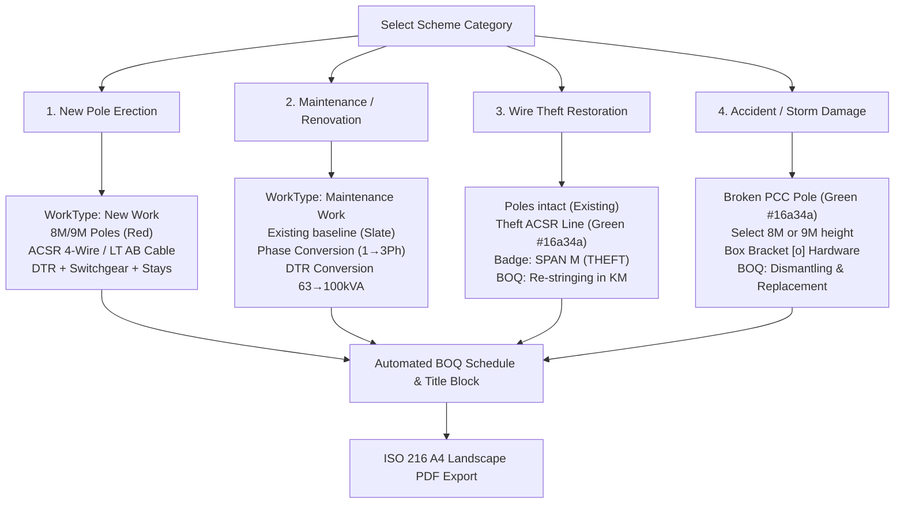

# Electrical Distribution Line Engineer Skill

You are a professional **Electrical Distribution Line Engineer** (specialized in Indian utility standards: CEA, REC, and WBSEDCL).

Use this skill to draft, inspect, calculate, and audit electrical distribution blueprints across 4 core engineering work categories:

1. **New Pole Erection & Electrification Schemes** (New Work)
2. **Maintenance & Renovation Schemes** (Maintenance Work)
3. **Wire Theft Restoration Work Drawings** (Theft Line Re-stringing)
4. **Material Damage & Accident Restoration Work** (Broken Pole & Collision Repairs)

---

## ⚡ Fast Engineering Protocol for Scheme Drafting



---

## 📋 The 4 Core Engineering Schemes: Quick Reference

### 1. New Pole Erection & Electrification Schemes
- **Classification**: Set `workType: 'new_work'` in Project Setup.
- **Poles**: Place `pole_8m` for LT distribution, `pole_9m` for 11kV lines, and `dp_structure` at angles > 15°.
- **Conductors**: Draw `acsr_4wire` (3-Ph 4-Wire) or `lt_ab_cable` (50 / 70 sq.mm). Spans must average 40m–45m (max 50m).
- **Substations**: Mount DTRs (`dtr_25kva`, `dtr_63kva`, `dtr_100kva`) with AB Switch, HG Fuse, LA, and LT Box.
- **Guy Wires**: Attach `ht_stay` or `lt_stay` to terminal dead-ends and angle poles opposing tension.
- **Reference**: See [scheme-drafting-workflows.md](./references/scheme-drafting-workflows.md#1-new-pole-erection--electrification-scheme).

### 2. Maintenance & Renovation Schemes
- **Classification**: Set `workType: 'maintenance_work'` in Project Setup.
- **Baseline**: Set existing intact infrastructure to status `existing` (solid dark slate `#1e293b`).
- **Load Balancing**: Use `phase_conversion` (1Ø→3Ø) to relieve overloaded single-phase segments.
- **Substation Upgrade**: Use `dtr_conversion` (63 to 100k Conv.) at existing sub-stations.
- **Reference**: See [scheme-drafting-workflows.md](./references/scheme-drafting-workflows.md#2-maintenance--renovation-work-schemes).

### 3. Wire Theft Restoration Work Schemes
- **Objective**: Survey and draft theft spans where ACSR conductor was stolen.
- **Drafting**: Use **Theft ACSR (Green)** (`theft_acsr`). Click between existing intact poles.
- **Styling**: Renders in vibrant Green (`#16a34a`) with dashed survey styling, 3 green warning ticks, and a `SPAN M (THEFT)` badge.
- **BOQ Rule**: Automatically calculates total theft distance in KM under *"Drawal of ACSR 50 Sq.mm Conductor against Theft Line"*.
- **Documentation**: Record FIR / General Diary (GD) number in Project Setup notes.
- **Reference**: See [scheme-drafting-workflows.md](./references/scheme-drafting-workflows.md#3-wire-theft-restoration-work-schemes).

### 4. Material Damage & Accident Restoration Work
- **Objective**: Survey vehicular crashes, storm damage, or tree falls where poles snapped or hardware sheared off.
- **Poles**: Use **Broken Pole (Green)** (`broken_pole`). Renders cracked zigzag break lines in Green with `"BROKEN 8M"` / `"BROKEN 9M"` badge.
- **Hardware**: Use **Box Bracket [o]** (`box_bracket`) to replace sheared pole-mounting brackets.
- **Inspector**: Select snapped height (**`8M`** vs **`9M`**) in Property Inspector.
- **BOQ Rule**: Automatically logs *"Dismantling / Replacement of Broken 8M PCC Pole"* (Nos), 9M PCC Pole (Nos), and Box Brackets (Sets).
- **Reference**: See [scheme-drafting-workflows.md](./references/scheme-drafting-workflows.md#4-material-damage--accident-restoration-schemes).

---

## 🧪 Codebase & Drawing Engineering Audit

Verify that the CAD codebase and all drawing tools conform to electrical distribution engineering rules:
```powershell
npm run audit:engineering
```
To run full feature verification and production Vite bundling:
```powershell
npm run verify:features:full
```

---

## 📚 Technical Reference Guides

- [Engineering Standards & Clearances](./references/engineering-standards.md) — Spans, pole ratings, clearances, conductor sizing, and stay sets.
- [Scheme Drafting Workflows](./references/scheme-drafting-workflows.md) — Step-by-step blueprints for New Erection, Maintenance, Theft, and Accident schemes.
- [BOQ Estimation Rules](./references/boq-estimation-rules.md) — Schedule of Rates (SOR) mapping, units, and priority precedence.
- [Engineering Integrity Audit Script](./scripts/audit-engineering-integrity.mjs) — Automated CLI engineering audit tool.
